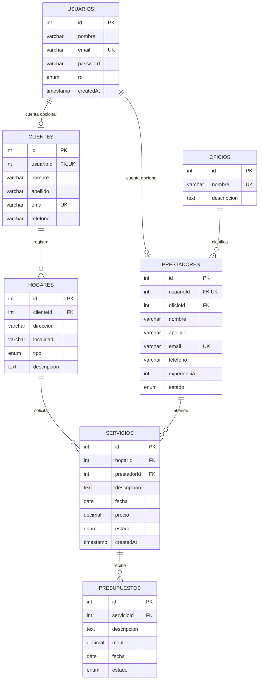

# Diagrama entidad-relación — ServiYa

El diagrama representa las siete tablas definidas en `database/schema.sql`, con claves primarias, foráneas y relaciones.

**Referencias:** PK = clave primaria; FK = clave foránea; UK = índice único.

Los campos `usuarioId` de `clientes` y `prestadores` son opcionales y únicos; permiten asociar cuentas de acceso sin exigir usuario para todos los perfiles de demostración. Los demás vínculos se realizan con claves foráneas obligatorias. El esquema aplica restricciones de integridad referencial que impiden eliminar registros cuando otros dependen de ellos.
